<p align="center">
  <a href="https://tinna-mongkolsaomoke-portfolio.netlify.app/">
    
  </a>
</p>

<p align="center">
  <picture>
    <source media="(prefers-color-scheme: dark)" srcset="./dark_mode.svg">
    <source media="(prefers-color-scheme: light)" srcset="./light_mode.svg">
    
  </picture>
</p>

```python
class Tinna:
    def __init__(self):
        self.role       = "3rd-year AI student @ Mahidol University, Faculty of ICT"
        self.experience = ["AI Engineer Intern @ ETDA (May–Jul 2026)"]
        self.building   = ["LLM agents", "RAG pipelines", "MCP tool integrations"]
        self.also_into  = ["computer vision", "IoT", "UX/UI design"]
        self.awards     = ["Top 10 Finalist × 2 — MuRata Hackathon 2025"]

    def say_hi(self):
        return "Let's build something useful together 🚀"
```

### 🚀 Featured work

- **AI Compliance Monitoring** · *ETDA internship*: multimodal LLM agents (via MCP) that check Shopee, Lazada, and TikTok Shop listings for TIS and Thai FDA certification, built for 3,000+ listings per day
- **[Document Q&A with RAG](https://github.com/nanatinna/Document-Q-A-System-with-RAG)**: LangChain + ChromaDB pipeline for questions over technical and financial documents, with about 40% better retrieval
- **WiFi CSI Elderly Monitoring** · 🏆 *Top 10, MuRata 2025*: camera-free activity recognition with ESP32, Raspberry Pi, and a CNN
- **BinMate** · 🏆 *Top 10, MuRata 2025*: computer-vision waste sorting with a real-time IoT dashboard
- **Velocità**: full-stack car rental app built with React, NestJS, and SQL
- **Climate Temperature Risk Modeling**: KDE and regression on 283k+ observations across six continents
