<p align="center">
  <a href="https://tinna-mongkolsaomoke-portfolio.netlify.app/">
    
  </a>
</p>

<p align="center">
  <picture>
    <source media="(prefers-color-scheme: dark)" srcset="./dark_mode.svg">
    <source media="(prefers-color-scheme: light)" srcset="./light_mode.svg">
    
  </picture>
</p>

```python
class Tinna:
    def __init__(self):
        self.role       = "3rd-year AI student @ Mahidol University, Faculty of ICT"
        self.experience = ["AI Engineer Intern @ ETDA (May–Jul 2026)"]
        self.building   = ["LLM agents", "RAG pipelines", "MCP tool integrations"]
        self.also_into  = ["computer vision", "IoT", "UX/UI design"]
        self.awards     = ["Top 10 Hackathon Finalist × 3"]

    def say_hi(self):
        return "Let's build something useful together 🚀"
```

### 🚀 Featured work

<p align="center">
  <picture>
    <source media="(prefers-color-scheme: dark)" srcset="./projects_dark.svg">
    <source media="(prefers-color-scheme: light)" srcset="./projects_light.svg">
    
  </picture>
</p>

<p align="center">
  <sub>🔗 <a href="https://github.com/Sannn-boo/CrowdX">CrowdX repo</a> · <a href="https://github.com/nanatinna/Document-Q-A-System-with-RAG">Document Q&amp;A repo</a> · <a href="https://tinna-mongkolsaomoke-portfolio.netlify.app/">more on my portfolio →</a></sub>
</p>

### 🧰 Tech stack

<table align="center">
  <tr>
    <td align="right"><code>// languages</code></td>
    <td></td>
  </tr>
  <tr>
    <td align="right"><code>// ai &amp; ml</code></td>
    <td>
      <br>
          
    </td>
  </tr>
  <tr>
    <td align="right"><code>// web</code></td>
    <td></td>
  </tr>
  <tr>
    <td align="right"><code>// data</code></td>
    <td></td>
  </tr>
  <tr>
    <td align="right"><code>// tools &amp; hardware</code></td>
    <td></td>
  </tr>
</table>
